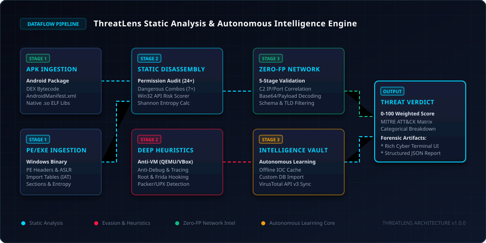

# ThreatLens Security Suite

### Advanced Static Malware Triage and Autonomous Threat Intelligence Engine

[](https://www.python.org/)
[](https://github.com/)
[](https://github.com/)
[](LICENSE)
[](https://attack.mitre.org/)
[](https://github.com/)
[](https://github.com/)

---

## Executive Overview

**ThreatLens** is an enterprise-grade, cross-platform static malware analysis and reverse-engineering framework designed for security operations centers (SOC), incident response (IR) units, and malware analysts. It executes deep static inspection of Android applications (`.apk`) and Windows Portable Executables (`.exe`), extracting command-and-control (C2) infrastructure, cryptographic signatures, high-risk API chains, and anti-analysis evasion tactics without executing untrusted code.

Equipped with a self-evolving **Autonomous Learning Engine**, ThreatLens correlates local findings with global reputation feeds, commits confirmed indicators of compromise (IOCs) to an encrypted offline vault, and enables air-gapped detection of recurring adversary infrastructure with zero network dependency.

---

## Terminal Demonstration



---

## System Architecture

ThreatLens processes artifacts through a multi-tier static extraction pipeline, feeding raw structural telemetry into specialized heuristics engines, a zero-false-positive network validator, and an autonomous threat-scoring matrix.



---

## Core Capabilities

### 1. Autonomous Learning Engine
* **Local Threat Vault** — Automatically harvests hashes, C2 IP addresses, domains, and gate URLs from high-confidence detections and stores them in a local offline database (`signatures/local_threat_intel.json`).
* **Air-Gapped Operation** — Once an adversary signature is recorded, ThreatLens flags future appearances locally without relying on external API queries.
* **Custom Threat Feed Ingestion** — Ingest external intelligence feeds via `--import-intel` in standardized JSON schema.

### 2. Deep Heuristics and Anti-Analysis Detection
* **Anti-Virtual Machine (Anti-VM)** — Detects environment probes targeting QEMU pipes (`qemu_pipe`), Goldfish, Genymotion, VirtualBox (`vbox86p`), Nox Player, and virtualization properties (`ro.kernel.qemu`, `ro.hardware`).
* **Anti-Debugging and Instrumentation** — Flags calls to `isDebuggerConnected`, `waitingForDebugger`, and dynamic binary instrumentation hooks (`frida-server`, `xposed`, `substrate`).
* **Root and Privilege Probes** — Scans for binary elevation vectors including `su` binary paths (`/system/bin/su`, `/system/xbin/su`, `/sbin/su`) and management packages (`Superuser.apk`).
* **Enterprise Obfuscator Identification** — Identifies commercial and APT packers including **DexGuard**, **Bangcle** (`libSecShell.so`), **SecNeo** (`libsecexe.so`), **Tencent Sec** (`libtup.so`), and **360 Jiagu**.

### 3. Android APK Deep Inspection
* **Manifest Auditing** — Parses compiled binary XML (`AndroidManifest.xml`), extracting exported services, broadcast receivers, deep-link schemes, and SDK targets.
* **Granular Permission Scoring** — Assesses 24+ high-risk Android permissions across espionage, financial fraud, surveillance, and privilege persistence.
* **Adversary Permission Clustering** — Correlates concurrent permission requests to expose signature attack vectors:
  * *Banking Trojan Pattern*: `SEND_SMS` + `RECEIVE_SMS` + `SYSTEM_ALERT_WINDOW` (OTP interception + credential phishing overlays).
  * *Spyware Vector*: `RECORD_AUDIO` + `ACCESS_FINE_LOCATION` + `CAMERA` (covert ambient surveillance).
* **DEX and Bytecode Analysis** — Extracts embedded strings, suspicious reflection API calls, and native library calls.
* **Resource and Shared Object Auditing** — Traverses compiled `.arsc` tables and native `.so` ELF binaries for hidden Firebase keys and obfuscated C2 endpoints.

### 4. Windows Portable Executable (PE) Analysis
* **Authenticode Digital Signature Verification** — Validates digital certificates against the Windows trust store and catalog database, establishing authentic trust for Microsoft Windows operating system components and signed enterprise software to eliminate false positives.
* **Header and Security Mitigations** — Validates machine architecture, subsystem, compile timestamps, and exploit mitigations (**ASLR**, **DEP/NX**).
* **Import Address Table (IAT) Triangulation** — Scans 80+ Win32/NT APIs categorized into execution, injection, evasion, and persistence categories.
* **Shannon Entropy and Packing Diagnostics** — Calculates byte entropy per section (`.text`, `.data`, `.rsrc`). Flags sections exceeding 7.0 entropy as crypted or packed. Identifies UPX, Themida, and VMProtect markers.

### 5. 5-Stage Zero-FP Network Extraction Pipeline
Extracted strings pass through five strict validation layers to eliminate false positives:
1. **Regex Extraction**: High-precision boundary matching for IPv4, FQDNs, and URLs.
2. **Schema and RFC Normalization**: Filtering against private subnets (RFC 1918), loopback ranges (127.0.0.0/8), multicast, and broadcast spaces.
3. **Domain Whitelist Filtering**: Elimination of clean OS infrastructure, CDNs, Android schema namespaces (`schemas.android.com`), and compiler artifacts.
4. **Context-Aware Port Triangulation**: Correlation of IP endpoints with typical Remote Access Trojan (RAT) ports (e.g., 8080, 4444, 1337, 8888, 5552).
5. **Base64 Payload Deobfuscation**: Recursive decoding of obfuscated payloads concealing network indicators.

### 6. Remote C2 & IP Infrastructure Intelligence
Extracted public IPv4 addresses are profiled in real time:
* **Reverse DNS Attribution**: Queries PTR records to resolve hostnames, dynamic DNS domains, and C2 servers.
* **VirusTotal IP Intelligence**: Queries live multi-engine reputation across 90+ security vendors for each extracted IP.
* **Autonomous System & GeoIP**: Identifies the hosting organization (AS Owner), ASN, and country of origin.
* **Adversary Port Fingerprinting**: Flags specialized RAT ports (Metasploit `4444`, Elite RAT `1337`, ADB botnet `5555`, C2 Gate `8888`).
* **Cross-Correlation Scoring**: If an extracted IP is flagged as malicious on global feeds, ThreatLens elevates the sample's threat score even if the sample's file hash is completely new and unseen.

### 7. Zero-Day & FUD Malware Detection Engine
Adversaries frequently recompile, pack, or crypt malware to generate novel hashes with 0 detections on VirusTotal. ThreatLens neutralizes this blind spot:
* **Behavioral Discrepancy Detection**: ThreatLens decouples detection from hash lookups. Even when VirusTotal returns `0/70` or `not_found`, ThreatLens evaluates functional API combinations, permission chains, and section entropy.
* **Zero-Day Anomaly Advisory**: When ThreatLens identifies high-confidence malicious capabilities alongside 0 VirusTotal detections, it issues an immediate **ZERO-DAY ANOMALY DETECTED** alert warning analysts not to trust the clean hash status.

### 8. Self-Training Autonomous Learning Engine
ThreatLens implements a continuous learning feedback loop:
* **Autonomous Knowledge Vault Feedback**: When ThreatLens analyzes an untrusted sample and confirms high-confidence maliciousness (via multi-engine consensus or lethal MITRE combinations), `learning_engine.py` automatically extracts malicious SHA-256 hashes, C2 IP addresses, domains, and gate URLs.
* **Offline Knowledge Vault**: Harvested indicators are committed locally to `signatures/local_threat_intel.json`. Future appearances of this infrastructure are flagged immediately in air-gapped environments without external network queries.
* **Feature Vector Classification**: Analyzes structural feature vectors (section entropy distribution, import function hashes / Imphash, permission clustering) to score malware families autonomously.

---

## MITRE ATT&CK Mapping Matrix

ThreatLens maps discovered behaviors directly to the MITRE ATT&CK enterprise and mobile frameworks:

| Technique ID | Technique Name | Detection Vector / Trigger | Severity |
| :--- | :--- | :--- | :--- |
| **T1055** | Process Injection | `VirtualAllocEx` + `WriteProcessMemory` + `CreateRemoteThread` | CRITICAL |
| **T1056.001** | Keylogging | `SetWindowsHookExW` / `GetAsyncKeyState` imports | HIGH |
| **T1012** | Query Registry | `RegOpenKeyExW` / `RegQueryValueExW` persistence scanning | MEDIUM |
| **T1497** | Virtualization / Sandbox Evasion | QEMU pipe checks, Genymotion hardware inspection | HIGH |
| **T1622** | Debugger Evasion | `isDebuggerConnected`, `CheckRemoteDebuggerPresent` | HIGH |
| **T1418** | Application Discovery | Root inspection (`/system/xbin/su`), Frida server probing | HIGH |
| **T1027** | Obfuscated / Compressed Code | Section entropy > 7.0, Bangcle / DexGuard native signatures | HIGH |
| **T1071.001** | Web Protocols (C2) | Extracted external domain and IP infrastructure | HIGH |
| **T1588.002** | Automated Exploit Tooling | UPX / Themida / VMProtect packer matches | MEDIUM |

---

## Technical Specifications

| Parameter | Specification |
| :--- | :--- |
| **Primary Languages** | Python 3.9+ |
| **Supported File Formats** | Android Package (`.apk`), Windows Portable Executable (`.exe`), MS-DOS (`.dll`, `.sys`) |
| **Disassembly Core** | Androguard (AXML/DEX), pefile, Capstone Engine |
| **Pattern Matching** | YARA 4.3+, Compiled C-extensions |
| **Terminal Rendering** | Rich Terminal Framework (ANSI/TrueColor 24-bit) |
| **Export Formats** | ANSI Cyber Terminal Stream, Structured JSON Telemetry |
| **Platforms Supported** | Windows 10/11, Windows Server 2019+, Ubuntu 20.04+, Debian 11+, RHEL/Fedora, macOS |

---

## Installation

### Prerequisites
* Python 3.9 or higher
* Git

### Setup Instructions

```bash
# Clone the repository
git clone https://github.com/your-org/ThreatLens-Security-Suite.git
cd ThreatLens-Security-Suite

# Create a virtual environment (recommended)
python -m venv venv

# Activate the virtual environment
# Windows:
venv\Scripts\activate
# Linux/macOS:
source venv/bin/activate

# Install required dependencies
pip install -r requirements.txt
```

---

## Configuration

ThreatLens supports hybrid operation: it functions 100% offline out-of-the-box, or can interface with global reputation feeds when configured.

Edit `config.json` in the root directory:

```json
{
    "virustotal_api_key": "YOUR_VIRUSTOTAL_API_KEY",
    "vt_enabled": true,
    "confidence_threshold": 40,
    "max_report_strings": 100
}
```

* Leave `"virustotal_api_key"` blank to operate in strict air-gapped / offline mode.
* `"confidence_threshold"` defines the minimum confidence percentage (0-100) required to report suspicious network indicators.

---

## Usage

ThreatLens provides both an interactive terminal console and non-blocking command-line options for automation and CI/CD pipelines.

### 1. Interactive Control Console
Launch the unified dashboard:

```bash
python threatlens.py
```

Features:
* Ingest files via terminal input path.
* Drag-and-drop file path support.
* GUI file and directory picker integration.
* Interactive report browser with instant assessment view.
* Real-time system diagnostics and local intelligence cache counter.

### 2. Single Artifact Triage (CLI)
Analyze a specific binary without interactive prompts:

```bash
# Analyze a sample and output both console telemetry and JSON report
python threatlens.py --file malware_sample.apk

# Direct output to JSON report only
python threatlens.py --file sample.exe --output json
```

### 3. Automated Batch Directory Scanning
Recursively triage folders containing multiple APK and EXE files:

```bash
python threatlens.py --batch ./samples/
```

### 4. Custom Threat Feed Ingestion
Inject custom Indicators of Compromise (hashes, IPs, domains, URLs) into the local intelligence vault:

```bash
python threatlens.py --import-intel custom_indicators.json
```

---

## Output Telemetry

ThreatLens exports forensic data to `reports/threatlens_<artifact>_<timestamp>.json`:

```json
{
  "tool": "ThreatLens",
  "version": "1.0.0",
  "scan_timestamp": "2026-10-31T13:19:22.128456",
  "file_info": {
    "filename": "sample.exe",
    "filepath": "C:\\samples\\sample.exe",
    "size_bytes": 360448,
    "file_type": "EXE",
    "hashes": {
      "md5": "ffc9cb93f506ef7748c5c412768add3c",
      "sha1": "7b379672d69452357d693fbbdd913c4eeec1ced2",
      "sha256": "2d0b3948c1edc5c6a1d1f3e3658613252cfbbfa1b98b46cb7cc8e5b6b8b0e8e9"
    }
  },
  "threat_assessment": {
    "score": 70,
    "severity": "HIGH",
    "breakdown": {
      "Imports": 35,
      "Network Indicators": 10,
      "YARA Matches": 0,
      "Suspicious Strings": 20,
      "Entropy": 5
    }
  },
  "analysis": {
    "pe_info": {
      "machine_type": "IMAGE_FILE_MACHINE_AMD64",
      "aslr_enabled": true,
      "dep_enabled": true
    },
    "network": [
      {
        "type": "URL",
        "value": "hxxp://malicious-telemetry.cc/gate",
        "port": 80,
        "confidence": 92
      }
    ]
  }
}
```

---

## Directory Layout

```
ThreatLens-Security-Suite/
|-- assets/
|   |-- threatlens_demo.svg          # High-resolution animated terminal triage demo
|   `-- threatlens_architecture.svg  # Animated end-to-end dataflow pipeline diagram
|-- core/
|   |-- apk_analyzer.py              # Android DEX, manifest & permission audit engine
|   |-- entropy_analyzer.py          # Shannon entropy & section cryptanalysis
|   |-- exe_analyzer.py              # Portable Executable (PE/COFF) structural parser
|   |-- heuristics.py                # Anti-VM, Anti-Debug, and Obfuscation signatures
|   |-- ip_analyzer.py               # C2 infrastructure attribution & VirusTotal IP profiler
|   |-- learning_engine.py           # Autonomous offline learning & IOC repository
|   |-- network_extractor.py         # 5-Stage Zero-FP C2 network extraction pipeline
|   |-- report_generator.py          # Telemetry JSON serializer and report writer
|   |-- threat_scorer.py             # Weighted multi-factor risk scoring engine
|   `-- virustotal.py                # VirusTotal v3 API reputation lookup client
|-- signatures/
|   |-- local_threat_intel.json      # Offline learned threat intelligence vault
|   |-- suspicious_imports.json      # Categorized Win32/NT suspicious API indicators
|   |-- suspicious_permissions.json  # Android permission risk matrix & descriptions
|   `-- yara_rules.yar               # Compiled YARA signatures for malware families
|-- ui/
|   |-- banner.py                    # Terminal banner, telemetry header & menu console
|   |-- dashboard.py                 # Segmented threat gauges & metadata cards
|   |-- tables.py                    # Color-coded forensic result tables
|   `-- theme.py                     # High-contrast cyber palette & symbol mappings
|-- utils/
|   |-- hash_calculator.py           # MD5, SHA-1, SHA-256 fingerprint calculations
|   |-- platform_utils.py            # Windows/Linux terminal compatibility helpers
|   `-- validators.py                # Magic byte identification & path sanitization
|-- .gitignore                       # Repository ignore rules (protects API keys & logs)
|-- config.example.json              # Public configuration template (commit to Git)
|-- config.local.json                # Private API key storage (git-ignored)
|-- config.json                      # System configuration & fallback
|-- requirements.txt                 # Python package dependencies
|-- setup.py                         # Standard package installer
`-- threatlens.py                    # Unified entrypoint (CLI & Interactive mode)
```

---

## Security and Compliance Disclosure

ThreatLens is engineered exclusively for authorized security research, academic study, reverse-engineering defense, and forensic evaluation. Users must obtain authorization prior to analyzing proprietary binaries or infrastructure. The authors assume no liability for misuse, unauthorized triage, or illegal activity conducted with this framework.

---

## License

This project is licensed under the MIT License. See [LICENSE](LICENSE) for full legal text.
